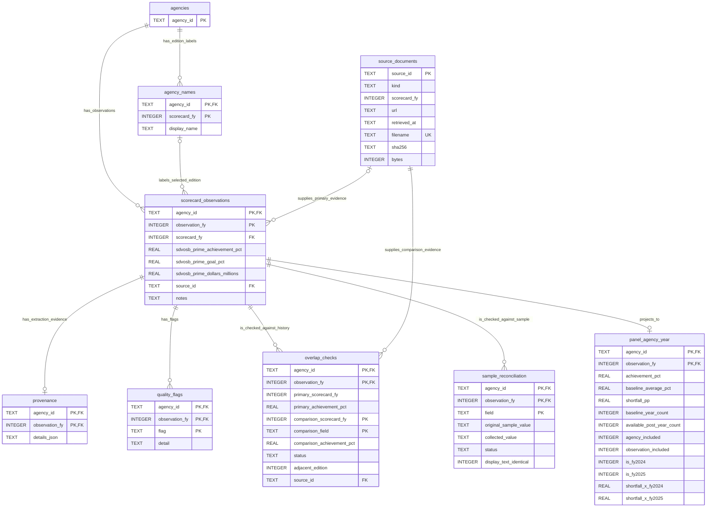

# SQLite database design and ERD

## Purpose and grain

The Assignment 4 database stores the collected SBA SDVOSB scorecard data, its
source evidence, validation comparisons, and deterministic preparation features.
It supports reproducible data management for the submitted project design. It
does not fit a model or interpret relationships in the data.

The principal grain is one federal agency and observation fiscal year. The
sample defines 24 stable agency identifiers and FY2020–FY2025, producing 144
required keys. A missing outcome does not remove its agency-year key. The
executable definition is [`schema.sql`](../src/sdvosb_federal_analytics/schema.sql);
[`DATA_DICTIONARY.md`](DATA_DICTIONARY.md) specifies every column, unit, and rule.

## Entity-relationship diagram

`PK` denotes a primary-key component, `FK` denotes a foreign-key component, and
`UK` denotes a unique key. Repeated PK markings form a composite key. A composite
FK must be joined on all of its columns together. Optional relationships below
describe what the SQL schema permits, including diagnostic outputs from an
incomplete collection; a successful full build has stronger completeness rules.

### Relationships and cardinality

| Parent key | Child foreign key | Relationship and business meaning |
|---|---|---|
| `agencies(agency_id)` | `agency_names(agency_id)` | One agency has zero or many edition-specific labels; each label belongs to exactly one agency. |
| `agencies(agency_id)` | `scorecard_observations(agency_id)` | One agency has zero or many observations; each observation belongs to exactly one agency. The full build requires six per agency. |
| `agency_names(agency_id, scorecard_fy)` | `scorecard_observations(agency_id, scorecard_fy)` | Each sourced observation uses exactly one matching agency/edition label. One label can describe multiple observation years, for example an own-year value and a prior-year fallback. SQL permits no matching label only when `scorecard_fy` is `NULL`, for a failed-source diagnostic row. |
| `source_documents(source_id)` | `scorecard_observations(source_id)` | One downloaded snapshot can supply many observations. Each observation selects at most one primary snapshot; a failed-source diagnostic can have no snapshot. |
| `scorecard_observations(agency_id, observation_fy)` | `provenance(agency_id, observation_fy)` | Zero or one evidence payload per observation. Successful source extraction creates one even when the displayed outcome is N/A. |
| `scorecard_observations(agency_id, observation_fy)` | `quality_flags(agency_id, observation_fy)` | Zero or many flags per observation, with each flag code appearing at most once for that key. |
| `scorecard_observations(agency_id, observation_fy)` | `overlap_checks(agency_id, observation_fy)` | Zero or many later-edition historical comparisons per observation. |
| `source_documents(source_id)` | `overlap_checks(source_id)` | Each comparison identifies exactly one later-edition snapshot; a snapshot can support many comparisons. This is the comparison source, not the primary observation source. |
| `scorecard_observations(agency_id, observation_fy)` | `sample_reconciliation(agency_id, observation_fy)` | Zero or many field comparisons per observation. A row is created only for a nonblank original sample field, with at most one comparison per field. |
| `scorecard_observations(agency_id, observation_fy)` | `panel_agency_year(agency_id, observation_fy)` | SQL permits zero or one derived row per observation; the ETL rebuild creates exactly one for every observation, including missing outcomes. |

All foreign keys use SQLite's default `NO ACTION` update/delete behavior. There
are no cascade deletes or update triggers. The loader enables foreign keys and
checks `PRAGMA foreign_key_check` and `PRAGMA integrity_check` before replacing
the output database. Other database clients must also enable
`PRAGMA foreign_keys = ON` for enforcement on their own connection.

## Normalization and controlled redundancy

### Canonical entities and facts

The design separates agency identity, source-edition labels, source documents,
and measured observations rather than putting repeated names and download
metadata in a single wide table. Stable agency identity is independent of a
source acronym or displayed label. `agency_names` uses the entire
`(agency_id, scorecard_fy)` key because the display label can vary by edition.
It records the label in the captured edition, not a legal name's effective-date
history: an online publisher can retrospectively rename old scorecards.

Each measured observation is unique on `(agency_id, observation_fy)`.
`observation_fy` identifies the period measured; `scorecard_fy` identifies the
edition used. They are normally equal, but they are not interchangeable. For
example, a FY2020 achievement can be obtained from the FY2021 prior-year field
when its own-year PDF is unavailable. Such a fallback does not provide FY2020
goal or dollars, and those fields stay missing.

`source_documents.source_id` is the SHA-256 digest of the downloaded bytes.
It is not a URL, an agency identifier, or a fiscal-year label. A URL can change
its contents, so the URL alone is insufficient provenance. The document relation
stores shared file/download metadata once and observations reference it. A
single database describes one collection snapshot, rather than every retrieval
of identical bytes over time. The frozen manifest additionally retains HTTP and
discovery metadata that are not columns in the relational schema.

These canonical relations follow the goal of third normal form: agency labels
and document-level metadata are not independently repeated as editable
observation facts. The complete database nevertheless includes explicit
redundancies and audit/derived relations; it is not claimed that every stored
column is an independent 3NF fact.

### Why the exceptions are retained

- `source_documents.sha256` deliberately repeats `source_id` to preserve the
  manifest's named checksum field. `CHECK(source_id = sha256)` prevents the two
  values from disagreeing; the checksum is computed from the saved bytes.
- An observation's `scorecard_fy` is retained as the composite-FK component for
  its edition label, although its primary source also carries an edition. The
  ETL supplies both from the same selection. SQL does not itself enforce equality
  between an observation's edition and its source document's edition.
- `scorecard_observations.notes` is the readable, pipe-separated export of
  record-specific quality messages. `quality_flags` supplies the structured
  one-row-per-flag form. Neither is a replacement for the source facts, and both
  are regenerated together.
- `provenance.details_json` is an immutable-style extraction evidence payload
  rebuilt from the frozen input. It intentionally repeats the key, edition,
  snapshot metadata, and flag codes alongside source display strings,
  footnotes, and field locators. Retaining these together makes an individual
  extraction reviewable without losing its original display precision. JSON is
  an audit envelope, not a second independently maintained table of numerical
  facts; normalized joins should be used for ordinary analysis.
- `overlap_checks` and `sample_reconciliation` retain both sides of a comparison
  and its result as build-time evidence. The primary value can also be found in
  the observation table, but keeping the compared values records what the
  validation actually compared. These audit rows are not additional outcomes.
- `panel_agency_year` intentionally materializes an analysis-ready projection.
  It repeats the outcome and agency-level baseline/count/inclusion values over
  agency-years, so its columns do not all depend only on the full composite key
  as independent facts. This is an explicit denormalization for downstream
  reproducibility and convenient filtering. It is fully rebuilt by
  [`panel.py`](../src/sdvosb_federal_analytics/panel.py), never hand-edited.

This separation prevents audit details and derived features from changing the
canonical meaning of the collected measurements. Corrections are made in source
selection or transformation code and validated through a rebuild. Neither
canonical facts nor the derived outputs are repaired by manual cell edits.

## Integrity and preparation rules

- The loader requires a unique 24-agency by six-year template. Primary keys
  reject duplicate agency-years and duplicate comparisons/flags at their
  respective grains. Foreign keys prevent orphan records.
- Percentage columns use displayed percent units: `2.30` means 2.30%, not
  0.023. Achievement and dollars can be negative. Goals must be between 0 and
  100 when present. Achievement above 100 is flagged rather than silently
  capped. Invalid numeric syntax fails parsing.
- Missing source values become empty CSV cells and SQL `NULL`, never zero.
  USAID FY2025 is a sourced N/A observation with a valid edition label and
  source reference. It is not a failed retrieval and must not lose provenance.
- Dollars are stored in millions of USD after unit conversion; the original
  display and rounding quantum remain in provenance. Conversion does not create
  precision beyond the rounded source.
- The baseline is the FY2021–FY2023 achievement mean only when all three values
  are present. Exposure is `max(0, 5 - baseline_average_pct)` in percentage
  points. An agency qualifies only with three baseline outcomes and at least
  one FY2024/FY2025 outcome. An observation qualifies only if that agency
  qualifies and that observation's achievement is present.
- The materialized panel retains all 144 keys. FY2020 is retained and uses the
  same observation-inclusion rule; an eventual analysis can specify a narrower
  period explicitly. The USAID FY2025 row remains present with
  `observation_included = 0`. No EDA, model estimates, or substantive results
  are produced by these feature definitions.

## Index strategy

SQLite automatically creates indexes for the declared primary keys and the
unique `source_documents.filename`. The composite keys begin with `agency_id`,
supporting agency histories and agency-year joins while enforcing uniqueness.
Foreign keys do not automatically create child-side indexes in SQLite.

| Explicit index | Indexed columns | Intended access pattern |
|---|---|---|
| `idx_observations_fy` | `scorecard_observations(observation_fy)` | Retrieve all agencies for one fiscal year without relying on an agency-first key. |
| `idx_observations_source` | `scorecard_observations(source_id)` | Trace a downloaded snapshot to the observations that use it. |
| `idx_flags_flag` | `quality_flags(flag)` | Retrieve all records carrying a particular issue or source-selection flag. |
| `idx_overlaps_source` | `overlap_checks(source_id)` | Retrieve validation comparisons supported by a particular comparison snapshot. |
| `idx_panel_fy_included` | `panel_agency_year(observation_fy, observation_included)` | Retrieve a year's included or excluded records; the leading year also supports year-only filtering. |

Additional indexes are unnecessary for this small dataset. In particular,
duplicating all composite primary-key indexes or indexing every nullable
measurement would add maintenance without a demonstrated access need. The
panel index is year-first; it does not promise an efficient lookup on the
inclusion flag alone. The final choice is therefore driven by identity,
provenance tracing, quality review, and expected agency/year access patterns.
